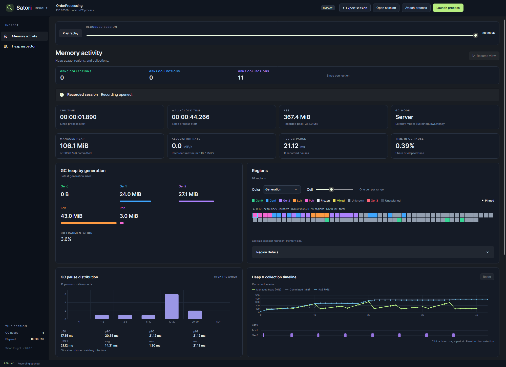
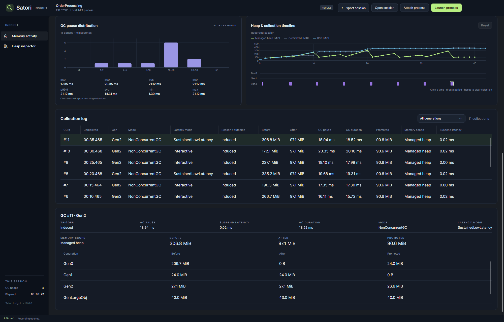
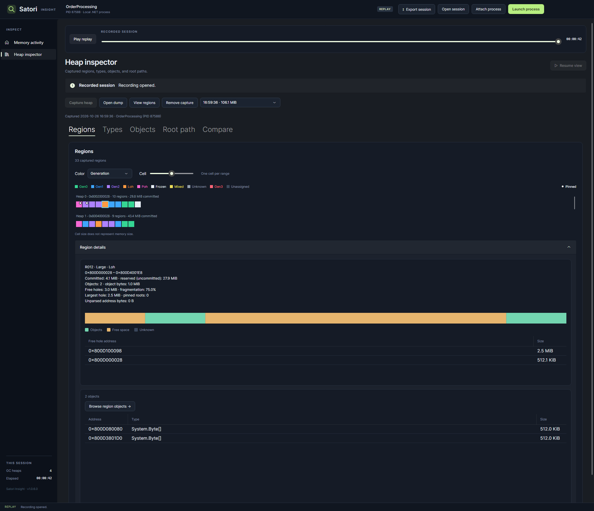

<h1> Satori Insight</h1>

A desktop profiler for exploring local .NET memory and garbage collection.

- Follow heap usage, allocation rate, CPU time, elapsed time, and resident memory.
- Inspect GC events, generation counts, pause distributions, and tail latency.
- Explore live memory regions and replay a selected point or period.
- Capture heaps, browse types and objects, follow root paths, and compare captures.
- Launch an application with custom arguments and environment variables, or attach to a running process.
- Save recordings and reopen them for offline analysis.

Available measurements depend on the target runtime. Remote processes and ordinary .NET Framework applications are not supported.

## Download

Download the package for your operating system and architecture from the [latest release](https://github.com/hez2010/SatoriInsight/releases/latest).

| Platform | x64 | ARM64 |
| --- | --- | --- |
| Windows | `SatoriInsight-win-x64.zip` | `SatoriInsight-win-arm64.zip` |
| macOS | `SatoriInsight-osx-x64.tar.gz` | `SatoriInsight-osx-arm64.tar.gz` |
| Linux (glibc) | `SatoriInsight-linux-x64.tar.gz` | `SatoriInsight-linux-arm64.tar.gz` |
| Linux (musl / Alpine) | `SatoriInsight-linux-musl-x64.tar.gz` | `SatoriInsight-linux-musl-arm64.tar.gz` |

## Screenshots



<details>
<summary>GC analysis and heap inspection</summary>

**Collection log and GC details**



**Captured regions and fragmentation**



</details>

## Build and run

Install the .NET 10 SDK. Building requires an Avalonia Pro Charts license supplied through the `AvaloniaUILicenseKey` environment variable.

```powershell
dotnet run --project SatoriInsight/SatoriInsight.csproj -c Release
```

To create a self-contained Windows build:

```powershell
dotnet publish SatoriInsight/SatoriInsight.csproj -c Release -r win-x64 --self-contained true -p:PublishTrimmed=true -o artifacts/publish
```

For NativeAOT, also install the Visual Studio C++ desktop build tools and Windows SDK:

```powershell
dotnet publish SatoriInsight/SatoriInsight.csproj -c Release -r win-x64 -p:PublishAot=true -o artifacts/publish-aot
```

## Start profiling

Choose **Attach process** or **Launch process**. Use **Memory activity** for live measurements and **Heap inspector** for captures.

See the [user guide](docs/user-guide.md) for the complete workflow and [troubleshooting](docs/troubleshooting.md) for connection, capture, and recording problems.

## Verify a source build

```powershell
dotnet test SatoriInsight.slnx -c Release
```

Running the tests requires the .NET 8 and .NET 10 runtimes.
